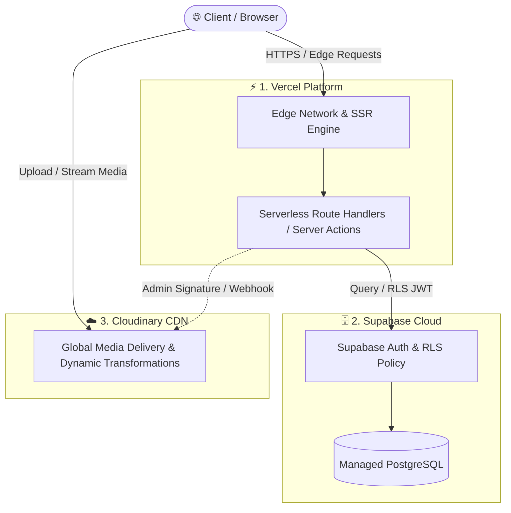

# 🌌 The Serverless Odyssey

[](https://nextjs.org/)
[](https://supabase.com/)
[](https://cloudinary.com/)
[](https://vercel.com/)
[](LICENSE)

> Repositori resmi proyek perkuliahan **The Serverless Odyssey**: Implementasi arsitektur Full-Stack Serverless modern berbasis standar DevSecOps, isolasi kredensial tingkat tinggi, serta performa komputasi terdistribusi di Edge.

---

## 🏛️ Arsitektur 4 Pilar (The 4 Pillars)

Proyek ini dibangun di atas 4 pilar cloud serverless yang saling melengkapi untuk mencapai skalabilitas elastis, ketersediaan tinggi, dan pemisahan tanggung jawab (separation of concerns):



1. **Next.js 16 (App Router & React 19)**:
   - Fondasi antarmuka dan backend terpadu memanfaatkan Server Components (RSC), Server Actions, dan Turbopack bundling untuk efisiensi render serta hidrasi minimal di sisi klien.
2. **Supabase Cloud (PostgreSQL & Row-Level Security)**:
   - Relational Database Serverless tangguh dengan PostgreSQL terkelola, sistem autentikasi aman, dan penegakan otorisasi di level basis data melalui Row-Level Security (RLS).
3. **Cloudinary CDN (Media & Asset Optimization)**:
   - Manajemen siklus hidup aset digital (gambar/video), kompresi otomatis berbasis format modern (AVIF/WebP), dan transformasi on-the-fly yang didistribusikan via multi-CDN global.
4. **Vercel (Edge Runtime & Global Delivery)**:
   - Infrastruktur hosting tanpa server dengan perutean komputasi terdekat ke pengguna melalui Vercel Edge Network, preview deployment terisolasi, dan zero-cold-start optimasi.

---

## 🔒 Higienitas DevSecOps & Manajemen Secrets

Repositori ini menerapkan aturan ketat terhadap integritas kredensial:
- **Zero Secret Leakage**: File `.env`, `.env.local`, dan varian `.env*.local` diabaikan oleh `.gitignore` dan **dilarang keras** di-commit ke Git.
- **Client vs Server Key Boundary**: Hanya variabel berawalan `NEXT_PUBLIC_` yang dapat diakses oleh browser (misal: `NEXT_PUBLIC_SUPABASE_ANON_KEY`). Variabel sensitif (misal: `SUPABASE_SERVICE_ROLE_KEY` & `CLOUDINARY_API_SECRET`) **hanya boleh dieksekusi di lingkungan server/edge**.
- **Public Audit**: File `.env.example` disediakan hanya sebagai template struktur nama variabel tanpa nilai rahasia.

---

## 🚀 Panduan Setup Lokal

### Prasyarat
- Node.js `>= 20.x`
- npm, pnpm, atau yarn
- Akun aktif di [Supabase](https://supabase.com) dan [Cloudinary](https://cloudinary.com)

### 1. Kloning Repositori & Instal Dependensi
```bash
git clone https://github.com/<username>/the-serverless-odyssey.git
cd the-serverless-odyssey
npm install
```

### 2. Konfigurasi Lingkungan (.env.example -> .env.local)
Salin template variabel lingkungan:
```bash
cp .env.example .env.local
```

Buka file `.env.local` dan isi kredensial dari dashboard layanan masing-masing:
```env
NEXT_PUBLIC_SUPABASE_URL=https://xxxxxxxxxxxx.supabase.co
NEXT_PUBLIC_SUPABASE_ANON_KEY=eyJh...
SUPABASE_SERVICE_ROLE_KEY=eyJh...

NEXT_PUBLIC_CLOUDINARY_CLOUD_NAME=your_cloud_name
CLOUDINARY_API_KEY=123456789012345
CLOUDINARY_API_SECRET=abcdefghijklmnopqrstuvwxyz123
NEXT_PUBLIC_CLOUDINARY_UPLOAD_PRESET=your_preset
```

### 3. Menjalankan Server Pengembangan
```bash
npm run dev
```
Buka browser pada [http://localhost:3000](http://localhost:3000).

---

## 🌿 Aturan 4 Langkah Git Branch (Git Flow Standard)

Untuk menjaga kebersihan repositori publik dan riwayat commit yang rapi, seluruh kolaborator wajib mematuhi **4 Langkah Git Branch**:

```
 1. Sync & Branch         2. Develop & Commit        3. Push to Remote        4. PR & Peer Review
      (main)                   (feat/...)               (origin/feat)                (Merge)
   ────────────► [ git checkout -b ] ────────────► [ git push -u ] ────────────► [ Pull Request ]
```

1. **Sinkronisasi & Buat Feature Branch Baru**:
   Jangan pernah mengembangkan fitur langsung di branch `main`. Tarik versi terbaru dan buat branch dengan penamaan terstandar (`feat/*`, `fix/*`, `chore/*`).
   ```bash
   git checkout main
   git pull origin main
   git checkout -b feat/nama-fitur-anda
   ```

2. **Pengembangan & Atomic Commit**:
   Lakukan perubahan terisolasi dan commit dengan pesan [Conventional Commits](https://www.conventionalcommits.org/):
   ```bash
   git add .
   git commit -m "feat(auth): integrate supabase rls auth provider"
   ```

3. **Publikasikan Branch ke Remote Repository**:
   Kirimkan perubahan ke remote GitHub untuk memicu pipeline validasi:
   ```bash
   git push -u origin feat/nama-fitur-anda
   ```

4. **Pull Request (PR) & Code Review**:
   - Buka Pull Request ke branch `main`.
   - Pastikan seluruh checklist keamanan (tidak ada secret leaks) dan uji linting lolos sebelum proses merge (Squash and Merge disarankan).

---

## 📄 Lisensi
Didistribusikan di bawah lisensi MIT. Lihat `LICENSE` untuk rincian lebih lanjut.
